<div align="center">

<!-- Header -->


<!-- Typing Animation -->
<a href="https://git.io/typing-svg"></a>

<br/>

[](https://portfolio-dev-code.vercel.app)
[](https://www.linkedin.com/in/mirzohid-ibrohimjonov)
[](https://t.me/Mirzohid_006_09_09)
[](mailto:ibrohimjonovm2006@gmail.com)


<a href="https://github.com/Mirzohiddev006?tab=followers"></a>

</div>

## 🌿 About Me

I'm a **full-stack developer from Tashkent, Uzbekistan 🇺🇿** who builds and ships complete products — from architecture and API design to a running production server.

- 🛒 Built and launched a **geolocation-based marketplace** (React + FastAPI + PostGIS) that is **live in production**
- 🏢 Build **B2B CRM systems, admin panels and Telegram bots** for clients
- 🤖 Integrate **OpenAI and Claude APIs** into real products and work with AI coding agents while keeping **tests and CI in the loop**
- 🎓 3rd-year **Management** student at Tashkent State University of Economics — brings planning and team coordination to the code
- 🧠 Former **captain of a national-level Zakovat team**

```python
class Mirzohid:
    location   = "Tashkent, Uzbekistan"
    role       = "Full-Stack Developer · AI Specialist · Prompt Engineer"
    frontend   = ["React 18", "TypeScript", "Tailwind", "shadcn/ui", "TanStack Query", "Zustand"]
    backend    = ["Python 3.12", "FastAPI", "SQLAlchemy 2.0", "PostgreSQL + PostGIS", "Redis"]
    ai         = ["OpenAI API", "Claude API", "RAG", "Prompt engineering", "Claude Code"]
    languages  = {"Uzbek": "native", "English": "intermediate"}
    open_to    = ["Full-stack roles", "Freelance projects", "AI product work"]
```

## 🧰 Tech Stack

<div align="center">

<table>
<tr>
<td align="center" width="170"><h3>🎨</h3><b>Frontend</b><br/><sub>UI that feels fast</sub></td>
<td><br/>
       
</td>
</tr>
<tr>
<td align="center" width="170"><h3>⚙️</h3><b>Backend</b><br/><sub>APIs that scale</sub></td>
<td><br/>
      
</td>
</tr>
<tr>
<td align="center" width="170"><h3>🤖</h3><b>AI</b><br/><sub>LLMs in production</sub></td>
<td>
     
</td>
</tr>
<tr>
<td align="center" width="170"><h3>🚀</h3><b>DevOps & Testing</b><br/><sub>Ship with confidence</sub></td>
<td><br/>
   
</td>
</tr>
</table>

</div>

## 💼 Experience

<table>
<tr>
<td width="50%" valign="top">

### 🟢 Freelance Full-Stack Developer
**Tashkent** · *June 2026 – Present*

- Built and launched a full-stack marketplace — architecture, API design and production deployment
- B2B CRM systems, admin panels and Telegram bots for clients
- Figma → accessible, responsive UIs
- AI coding agents with code review, tests and CI in the loop

</td>
<td width="50%" valign="top">

### 🟢 Frontend Developer
**Cognilabs Inc., Tashkent** · *Nov 2025 – 2026*

- Production React apps with a reusable component architecture
- Shipped AI features with OpenAI and Claude APIs
- Agile sprints with design and backend teams
- Faster page loads, cross-browser fixes, code reviews

</td>
</tr>
</table>

## 🚀 Featured Projects

<div align="center">



<a href="https://bunyodkor-fa-cims.vercel.app"></a>


</div>

## 📊 GitHub Stats

<div align="center">








</div>

## 🎓 Education & Leadership

| | |
| :-- | :-- |
| 🎓 **B.S. in Management (3rd year)** | Tashkent State University of Economics · 2024 – Present |
| 📜 **Courses** | AI Fundamentals, Prompt Engineering, React.js — Coursera, Udemy, DeepLearning.AI |
| 🧠 **Team Captain, Zakovat** | 2023 – 2024 · regional and national tournaments three years in a row |
| 🏛️ **Student Council** | TSUE · academic, cultural and social events |
| 🤝 **Volunteering** | Organizer at Tomchi Charity · Volunteer at Ocean Charity and Tashkent International Marathon |

<div align="center">

<picture>
  <source media="(prefers-color-scheme: dark)" srcset="https://raw.githubusercontent.com/Mirzohiddev006/Mirzohiddev006/output/github-contribution-grid-snake-dark.svg"/>
  <source media="(prefers-color-scheme: light)" srcset="https://raw.githubusercontent.com/Mirzohiddev006/Mirzohiddev006/output/github-contribution-grid-snake.svg"/>
  
</picture>


</div>
